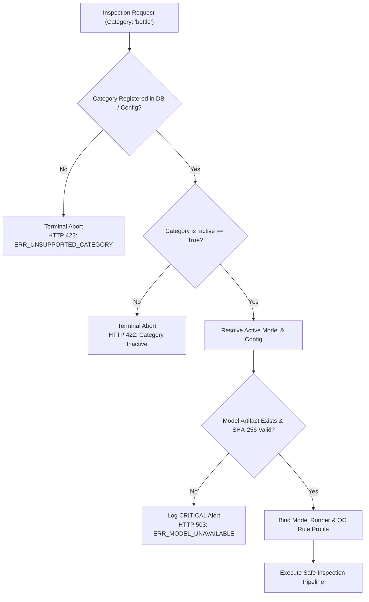

# VisionInspect AI — Configuration & Model Registry Specification

**Document ID:** VIA-ARCH-CFG-001  
**Version:** 1.0.0  
**Phase:** Phase 1 — Requirements Analysis & System Architecture Design  
**Author:** Shrikrishna Chavan (Individual Contributor)  
**Branch:** `shrikrishna-chavan`  
**Status:** Approved for Design Baseline  

---

## 1. Overview & Architectural Principles

A core tenet of industrial inspection systems is **zero hardcoded operational parameters**. Manufacturing line tolerances, optical lighting conditions, and defect severity thresholds vary drastically across product categories (`bottle` vs `tile`).

The VisionInspect AI configuration and model registry architecture provides:
1. **Category-Specific Parameter Binding:** Every category defines independent inference resolutions, binarization thresholds, and QC disposition rules.
2. **Dual-Tier Configuration (Database + Declarative YAML):** System defaults are stored in declarative YAML files for version-controlled auditing, and mirrored in PostgreSQL (`model_configurations`) for dynamic runtime adjustments.
3. **Cryptographically Verified Model Registry:** Model artifacts (weights, coreset banks) are referenced with explicit SemVer version strings and SHA-256 checksums.
4. **Deterministic Fallback & Fail-Safe Routing:** Any unknown category or missing checkpoint triggers a controlled fallback, routing inspections to `REVIEW` or a descriptive error, never an unverified `PASS`.

---

## 2. Configuration Directory & Schema Architecture

Default baseline configurations reside under `configs/categories/`:

```
configs/
├── system.yaml                     # Global system settings (device, logging, timeouts)
└── categories/
    ├── bottle.yaml                 # Bottle category-specific parameters
    ├── metal_nut.yaml              # Metal nut parameters
    └── tile.yaml                   # Tile parameters
```

### 2.1 Category Configuration Schema (`bottle.yaml`)
```yaml
category:
  slug: "bottle"
  display_name: "Glass & Plastic Bottles"
  description: "Inspection of bottles for structural cracks, breaks, and surface contamination"
  is_active: true

model:
  default_model_name: "patchcore"
  default_version: "1.0.0"
  architecture: "wideresnet50"
  input_resolution:
    width: 256
    height: 256
  device_preference: "cuda"          # "cuda" or "cpu"
  artifact_path: "artifacts/models/bottle/patchcore/v1.0.0/coreset.pt"
  sha256_hash: "8f4a132bc6e7d9834190283cba41e4649b934ca495991b7852b855aa12345678"

inference_parameters:
  tau_binary: 0.55                  # Pixel-level binarization threshold
  min_defect_area_px: 15            # Minimum connected pixel area to qualify as defect
  morphology:
    kernel_shape: "ellipse"
    kernel_size: 5

qc_rules:
  tau_pass: 0.45                    # Anomaly score < 0.45 AND defects==0 -> PASS
  tau_review: 0.60                  # 0.45 <= Anomaly score < 0.60 -> REVIEW
  tau_reject: 0.80                  # Anomaly score >= 0.80 -> REJECT
  max_rework_area_pct: 2.50         # Defect area <= 2.5% -> REWORK, > 2.5% -> REJECT
  max_defect_count: 5               # > 5 distinct defects -> REJECT
  min_confidence: 0.80              # < 0.80 confidence -> REVIEW
```

---

## 3. Model Registry Architecture

### 3.1 Registry Filesystem Organization
All serialized model artifacts are stored systematically within a structured filesystem directory:

```
artifacts/models/
├── bottle/
│   ├── patchcore/
│   │   └── v1.0.0/
│   │       ├── coreset.pt           # Coreset memory bank embeddings
│   │       ├── metadata.json        # Training hyperparameters & metrics
│   │       └── checksum.sha256      # Checksum verification file
│   └── unet/
│       └── v1.0.0/
│           ├── unet_best.pt         # PyTorch state dict weights
│           ├── metadata.json
│           └── checksum.sha256
├── metal_nut/
│   └── patchcore/v1.0.0/
└── tile/
    └── patchcore/v1.0.0/
```

### 3.2 Registry Metadata Schema (`metadata.json`)
```json
{
  "category": "bottle",
  "model_name": "patchcore",
  "version": "1.0.0",
  "architecture": "wideresnet50_2",
  "dataset_version": "mvtec_ad_2019_v1",
  "random_seed": 42,
  "training_timestamp": "2026-11-17T18:00:00Z",
  "coreset_subsampling_ratio": 0.10,
  "embedding_dimension": 1536,
  "coreset_size": 81920,
  "benchmark_metrics": {
    "image_auroc": 0.992,
    "pixel_auroc": 0.984,
    "pro_score": 0.941,
    "inference_latency_gpu_ms": 165.0
  },
  "artifact_file": "coreset.pt",
  "sha256": "8f4a132bc6e7d9834190283cba41e4649b934ca495991b7852b855aa12345678"
}
```

---

## 4. Dynamic Resolution & Fallback Workflow

When an inspection request arrives for a given category:



### Fallback Rules:
1. **Unknown Category:** If the supplied `category` parameter does not exist in the catalog, immediately reject with `HTTP 422 Unprocessable Content` (`ERR_UNSUPPORTED_CATEGORY`). Do not attempt a generic fallback.
2. **Missing Artifact on Disk:** If a category is active in the database but its weight file on disk is missing or fails checksum validation, return `HTTP 503 Service Unavailable` (`ERR_MODEL_UNAVAILABLE`).
3. **Dynamic Rule Reloading:** Updating a threshold in `model_configurations` or modifying `bottle.yaml` takes effect on the subsequent inspection request without restarting backend processes.
