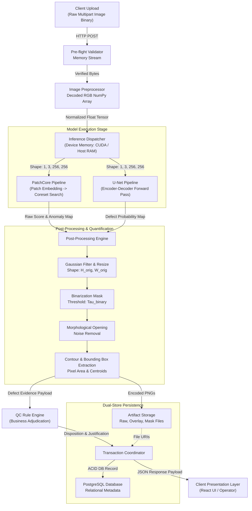

# VisionInspect AI — Data Flow Specification

**Document ID:** VIA-ARCH-DAT-001  
**Version:** 1.0.0  
**Phase:** Phase 1 — Requirements Analysis & System Architecture Design  
**Author:** Shrikrishna Chavan (Individual Contributor)  
**Branch:** `shrikrishna-chavan`  
**Status:** Approved for Design Baseline  

---

## 1. Overview

This document specifies the exact data transformations, tensor shapes, data types, memory representations, and serialization formats at every stage of the VisionInspect AI inspection pipeline.

---

## 2. End-to-End Pipeline Data Flow Diagram



---

## 3. Detailed Data Transformation Stages

### Stage 1: Ingestion & Pre-flight Validation
- **Input:** Raw HTTP `multipart/form-data` payload containing an image binary stream and form fields:
  ```json
  {
    "category": "bottle",
    "model_name": "patchcore",
    "model_version": "1.0.0"
  }
  ```
- **Validation Checks:**
  - MIME type string matches `image/jpeg` or `image/png`.
  - Stream length: $L_{\text{bytes}} \le 15 \times 1024 \times 1024$.
  - Magic bytes header check:
    - JPEG: `\xFF\xD8\xFF`
    - PNG: `\x89\x50\x4E\x47\x0D\x0A\x1A\x0A`
- **Output:** Validated in-memory byte buffer `io.BytesIO`.

---

### Stage 2: Preprocessing & Tensor Transformation
- **Step 2.1 (Decoding):** Decodes byte stream using OpenCV / Pillow into 8-bit unsigned integer RGB array:
  - **Data Structure:** NumPy `ndarray`
  - **Data Type:** `uint8`
  - **Dimensions:** $(H_{\text{orig}}, W_{\text{orig}}, 3)$, where $256 \le H_{\text{orig}}, W_{\text{orig}} \le 4096$.
  - **Value Range:** $[0, 255]$.
- **Step 2.2 (Resizing):** Bilinear interpolation with antialiasing to standard model input spatial dimensions:
  - **Target Resolution:** $(256, 256, 3)$.
- **Step 2.3 (Float Conversion & Channel Transpose):**
  - Scales values to float32 range $[0.0, 1.0]$.
  - Transposes dimensions from Channels-Last $(H, W, C)$ to Channels-First $(C, H, W)$.
  - **Dimensions:** $(3, 256, 256)$, `float32`.
- **Step 2.4 (Standard ImageNet Normalization):**
  - Subtracts channel mean $\mu = [0.485, 0.456, 0.406]$ and divides by $\sigma = [0.229, 0.224, 0.225]$.
- **Step 2.5 (Batch Expansion & Device Transfer):**
  - Adds batch dimension: $(1, 3, 256, 256)$.
  - Transfers tensor to target execution device (`torch.device("cuda:0")` or `"cpu"`).

---

### Stage 3: Model Inference Execution

#### Path A: PatchCore Pipeline
- **Step 3.A.1 (Feature Extraction):** Normalized tensor passes through frozen WideResNet-50-2 backbone. Intermediate feature maps are extracted from `layer2` and `layer3`:
  - `layer2` output shape: $(1, 512, 64, 64)$
  - `layer3` output shape: $(1, 1024, 32, 32)$
- **Step 3.A.2 (Patch Aggregation):** Features are spatially aligned to resolution $(64, 64)$ via bilinear interpolation, concatenated into local patch embeddings:
  - Feature representation shape: $(1, 1536, 64, 64) \rightarrow (4096, 1536)$.
- **Step 3.A.3 (Coreset Distance Computation):**
  - Computes $L_2$ Euclidean distance between each candidate patch embedding and its nearest neighbor in the stored coreset memory bank $\mathcal{M}_{\text{coreset}} \in \mathbb{R}^{N_{\text{coreset}} \times 1536}$:
    $$d_i = \min_{m \in \mathcal{M}} \| p_i - m \|_2$$
- **Step 3.A.4 (Score & Map Derivation):**
  - Patch distance array shaped to $64 \times 64$.
  - Image anomaly score $S_{\text{image}}$ computed as re-weighted maximum of patch distances.
  - Spatial map bilinearly upsampled to $(256, 256)$ `float32`.

#### Path B: U-Net Pipeline
- **Step 3.B.1 (Encoder-Decoder Propagation):**
  - Contracting path: 4 downsampling blocks with double convolutions, ReLU, and $2\times 2$ max pooling.
  - Bottleneck: Convolution block processing lowest-resolution latent features.
  - Expanding path: 4 upsampling blocks with transpose convolutions, skip connections concatenated from encoder stages.
- **Step 3.B.2 (Sigmoid Probability Output):**
  - $1 \times 1$ convolution mapped through Sigmoid activation $\sigma(z) = \frac{1}{1 + e^{-z}}$.
  - **Output Tensor:** $(1, 1, 256, 256)$, values in $[0.0, 1.0]$ `float32`.

---

### Stage 4: Post-Processing & Morphological Defect Localization
- **Step 4.1 (Spatial Gaussian Smoothing):**
  - The $256 \times 256$ anomaly map is filtered with a 2D Gaussian kernel ($\sigma=4.0$) to smooth patch transition boundaries.
- **Step 4.2 (Upsampling to Original Aspect & Resolution):**
  - Bilinearly interpolates the smoothed anomaly map back to $(H_{\text{orig}}, W_{\text{orig}})$ to enable pixel-exact alignment with the source image.
- **Step 4.3 (Binarization):**
  - Evaluates condition:
    $$B(x, y) = \begin{cases} 1 & \text{if } M(x, y) \ge \tau_{\text{binary}} \\ 0 & \text{otherwise} \end{cases}$$
  - **Output Structure:** NumPy boolean array $(H_{\text{orig}}, W_{\text{orig}})$ of type `uint8` ($\{0, 255\}$).
- **Step 4.4 (Morphological Opening):**
  - Applies morphological opening using a $5\times 5$ elliptical structuring element:
    $$B_{\text{clean}} = (B \circ K) = (B \ominus K) \oplus K$$
  - Eliminates isolated salt-and-pepper noise while retaining contiguous defect bodies.
- **Step 4.5 (Connected Component & Contour Extraction):**
  - Invokes `cv2.findContours(B_{\text{clean}}, cv2.RETR_EXTERNAL, cv2.CHAIN_APPROX_SIMPLE)`.
  - For each extracted contour $k$:
    - Bounding Box: $[x_{\min}, y_{\min}, x_{\max}, y_{\max}]$.
    - Area: $A_k = \sum_{(x, y) \in C_k} 1$ pixels.
    - Centroid: $(\bar{x}_k, \bar{y}_k) = \left(\frac{m_{10}}{m_{00}}, \frac{m_{01}}{m_{00}}\right)$.
- **Step 4.6 (Defect Geometry Quantification):**
  - Total Defect Area: $A_{\text{total}} = \sum_k A_k$.
  - Defect Area Ratio: $\rho = \frac{A_{\text{total}}}{H_{\text{orig}} \times W_{\text{orig}}} \times 100\%$.
  - Defect Count: $N_{\text{defects}} = \text{length}(contours)$.
- **Step 4.7 (Visual Artifact Generation):**
  - Encodes binary mask as 1-channel PNG (`{id}_mask.png`).
  - Generates composite overlay:
    - Anomaly map scaled to $0–255$ and colorized via `cv2.applyColorMap(..., cv2.COLORMAP_JET)`.
    - Blended with original RGB image at $60\% / 40\%$ alpha.
    - Rectangular bounding boxes and defect labels drawn in contrasting bright yellow (`(255, 255, 0)`).
    - Encoded as 3-channel PNG (`{id}_overlay.png`).

---

### Stage 5: Quality Control (QC) Rule Evaluation
- **Input:** `QCInputPayload` containing:
  - `anomaly_score`: $S_{\text{norm}} \in [0.0, 1.0]$
  - `defect_area_ratio_pct`: $\rho \in [0.0, 100.0]$
  - `defect_count`: $N_{\text{defects}} \in \mathbb{N}_0$
  - `max_component_area_px`: $\max(A_k)$
- **Evaluation Logic:** Rules evaluated against category-specific configuration parameters:
  - If $S_{\text{norm}} < \tau_{\text{pass}}$ and $N_{\text{defects}} == 0 \longrightarrow \textbf{PASS}$
  - If $\tau_{\text{pass}} \le S_{\text{norm}} < \tau_{\text{review}} \longrightarrow \textbf{REVIEW}$
  - If $S_{\text{norm}} \ge \tau_{\text{review}}$ and $\rho \le A_{\text{rework}} \longrightarrow \textbf{REWORK}$
  - If $S_{\text{norm}} \ge \tau_{\text{reject}}$ or $\rho > A_{\text{rework}}$ or $N_{\text{defects}} > C_{\max\_defects} \longrightarrow \textbf{REJECT}$
- **Output:** `QCDecision` object containing disposition enum, status string, and rule justification list.

---

### Stage 6: Persistence & Client Response Serialization
- **Step 6.1 (Filesystem Storage):**
  - Writes raw upload, overlay image, and binary mask to disk paths under `/artifacts/`.
- **Step 6.2 (PostgreSQL Relational Transaction):**
  - Inserts root row into `inspections` table.
  - Inserts associated child record into `inspection_results` table.
  - Inserts individual defect cluster rows into `defect_predictions` table.
  - Commits transaction atomically.
- **Step 6.3 (Response Serialization):**
  - Formats complete result into `InspectionResponse` Pydantic model and serializes to JSON over HTTP 201 Created.
