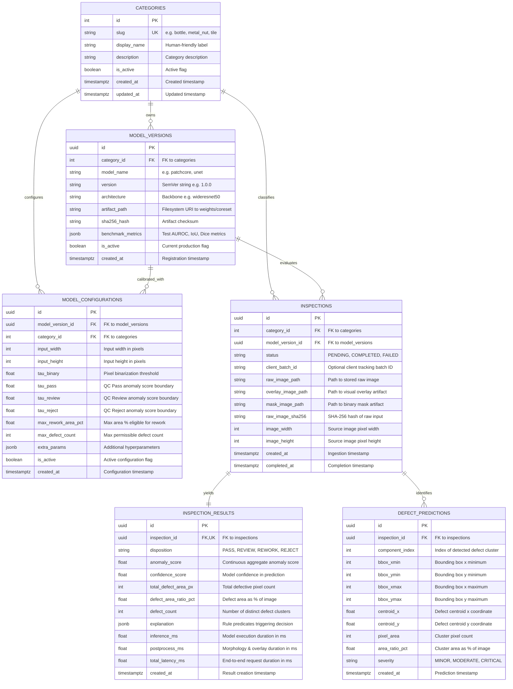

# VisionInspect AI — Database Architecture & Schema Specification

**Document ID:** VIA-ARCH-DB-001  
**Version:** 1.0.0  
**Phase:** Phase 1 — Requirements Analysis & System Architecture Design  
**Author:** Shrikrishna Chavan (Individual Contributor)  
**Branch:** `shrikrishna-chavan`  
**Status:** Approved for Design Baseline  

---

## 1. Overview & Architectural Principles

VisionInspect AI employs a normalized **PostgreSQL** relational database. The schema is designed to balance third-normal-form (3NF) relational integrity, fast indexed query performance for dashboard analytics, and full retrospective auditability.

Key principles:
1. **Immutable Inspection Records:** Inspection events and results represent immutable historical audit records. Updating existing inspection results is prohibited.
2. **Strict Foreign Key Cascades & References:** Every inspection is explicitly tied to an active product category, the specific model version used for inference, and the active configuration parameters.
3. **Artifact-Metadata Separation:** High-volume binary assets (images, masks, overlays) are stored in file storage; only sanitized relative URIs and cryptographic checksums are stored in the database.
4. **Optimized Indexes:** Composite B-tree indexes are placed on timestamp, category, and disposition columns to ensure sub-100ms dashboard aggregations.

---

## 2. Entity-Relationship Diagram



---

## 3. Detailed Entity Definitions & Rationale

### 3.1 Table: `categories`
- **Purpose:** Catalogs manufacturing product lines supported by the inspection platform.
- **Why Needed:** Decouples hardcoded category strings from inspection records; enables dynamic activation/deactivation of product lines without code modifications.
- **Schema:**
  ```sql
  CREATE TABLE categories (
      id SERIAL PRIMARY KEY,
      slug VARCHAR(50) NOT NULL UNIQUE,
      display_name VARCHAR(100) NOT NULL,
      description TEXT,
      is_active BOOLEAN NOT NULL DEFAULT TRUE,
      created_at TIMESTAMPTZ NOT NULL DEFAULT NOW(),
      updated_at TIMESTAMPTZ NOT NULL DEFAULT NOW()
  );
  CREATE INDEX idx_categories_slug ON categories(slug);
  ```

### 3.2 Table: `model_versions`
- **Purpose:** Stores the catalog of trained model weights, coreset banks, architectures, and evaluation benchmark results.
- **Why Needed:** Guarantees absolute model traceability. Any inspection performed in 2026 can be mapped back to the exact neural network checkpoint and SHA-256 hash that produced the inference.
- **Schema:**
  ```sql
  CREATE TABLE model_versions (
      id UUID PRIMARY KEY DEFAULT gen_random_uuid(),
      category_id INT NOT NULL REFERENCES categories(id) ON DELETE RESTRICT,
      model_name VARCHAR(50) NOT NULL,            -- e.g., 'patchcore', 'unet'
      version VARCHAR(20) NOT NULL,               -- e.g., '1.0.0'
      architecture VARCHAR(50) NOT NULL,          -- e.g., 'wideresnet50', 'standard_unet'
      artifact_path VARCHAR(255) NOT NULL,        -- Relative URI to checkpoint / coreset
      sha256_hash CHAR(64) NOT NULL,              -- Checksum for artifact integrity
      benchmark_metrics JSONB NOT NULL DEFAULT '{}'::jsonb, -- e.g., {"auroc": 0.985, "iou": 0.74}
      is_active BOOLEAN NOT NULL DEFAULT FALSE,   -- Flag indicating active production model
      created_at TIMESTAMPTZ NOT NULL DEFAULT NOW(),
      CONSTRAINT uq_category_model_version UNIQUE (category_id, model_name, version)
  );
  CREATE INDEX idx_model_versions_cat_active ON model_versions(category_id, is_active);
  ```

### 3.3 Table: `model_configurations`
- **Purpose:** Houses the calibrated inference and QC business thresholds for a given category and model version.
- **Why Needed:** Avoids hardcoding operational boundaries in Python application code. Line supervisors can fine-tune sensitivity thresholds dynamically.
- **Schema:**
  ```sql
  CREATE TABLE model_configurations (
      id UUID PRIMARY KEY DEFAULT gen_random_uuid(),
      model_version_id UUID NOT NULL REFERENCES model_versions(id) ON DELETE RESTRICT,
      category_id INT NOT NULL REFERENCES categories(id) ON DELETE RESTRICT,
      input_width INT NOT NULL DEFAULT 256,
      input_height INT NOT NULL DEFAULT 256,
      tau_binary FLOAT NOT NULL,                  -- Pixel binarization threshold
      tau_pass FLOAT NOT NULL,                    -- Max score for PASS
      tau_review FLOAT NOT NULL,                  -- Boundary for REVIEW
      tau_reject FLOAT NOT NULL,                  -- Threshold for mandatory REJECT
      max_rework_area_pct FLOAT NOT NULL,         -- Area limit for REWORK
      max_defect_count INT NOT NULL DEFAULT 5,     -- Max distinct defect count
      extra_params JSONB NOT NULL DEFAULT '{}'::jsonb,
      is_active BOOLEAN NOT NULL DEFAULT TRUE,
      created_at TIMESTAMPTZ NOT NULL DEFAULT NOW()
  );
  CREATE INDEX idx_model_configs_cat_active ON model_configurations(category_id, is_active);
  ```

### 3.4 Table: `inspections`
- **Purpose:** Root entity tracking the submission, processing lifecycle, input metadata, and artifact file pointers for an inspection job.
- **Why Needed:** Represents the immutable inspection event. Tracks ingestion status even if model inference or post-processing experiences an unexpected failure.
- **Schema:**
  ```sql
  CREATE TYPE inspection_status AS ENUM ('PENDING', 'PROCESSING', 'COMPLETED', 'FAILED');

  CREATE TABLE inspections (
      id UUID PRIMARY KEY DEFAULT gen_random_uuid(),
      category_id INT NOT NULL REFERENCES categories(id) ON DELETE RESTRICT,
      model_version_id UUID NOT NULL REFERENCES model_versions(id) ON DELETE RESTRICT,
      status inspection_status NOT NULL DEFAULT 'PENDING',
      client_batch_id VARCHAR(100),               -- Optional client batch identifier
      raw_image_path VARCHAR(255) NOT NULL,       -- Path to original image artifact
      overlay_image_path VARCHAR(255),            -- Path to rendered overlay artifact
      mask_image_path VARCHAR(255),               -- Path to binary mask artifact
      raw_image_sha256 CHAR(64) NOT NULL,         -- SHA-256 hash of raw input
      image_width INT NOT NULL,                   -- Original image resolution width
      image_height INT NOT NULL,                  -- Original image resolution height
      error_message TEXT,                         -- Detailed message if status = 'FAILED'
      created_at TIMESTAMPTZ NOT NULL DEFAULT NOW(),
      completed_at TIMESTAMPTZ
  );
  CREATE INDEX idx_inspections_category_created ON inspections(category_id, created_at DESC);
  CREATE INDEX idx_inspections_status ON inspections(status);
  ```

### 3.5 Table: `inspection_results`
- **Purpose:** Stores the adjudicated QC recommendation, aggregated anomaly scores, defect statistics, and execution timing breakdowns.
- **Why Needed:** Isolates operational results and high-level decision justifications in a 1-to-1 relationship with the root inspection, enabling rapid analytics queries without parsing granular defect arrays.
- **Schema:**
  ```sql
  CREATE TYPE qc_disposition AS ENUM ('PASS', 'REVIEW', 'REWORK', 'REJECT');

  CREATE TABLE inspection_results (
      id UUID PRIMARY KEY DEFAULT gen_random_uuid(),
      inspection_id UUID NOT NULL UNIQUE REFERENCES inspections(id) ON DELETE CASCADE,
      disposition qc_disposition NOT NULL,
      anomaly_score FLOAT NOT NULL,               -- Normalized continuous anomaly score
      confidence_score FLOAT NOT NULL DEFAULT 1.0, -- Model confidence metric
      total_defect_area_px INT NOT NULL DEFAULT 0, -- Total defective pixels
      defect_area_ratio_pct FLOAT NOT NULL DEFAULT 0.0, -- Defect area % of surface
      defect_count INT NOT NULL DEFAULT 0,         -- Count of distinct defect components
      explanation JSONB NOT NULL DEFAULT '[]'::jsonb, -- Array of triggered rule justifications
      inference_ms FLOAT NOT NULL,                -- ML model forward execution time
      postprocess_ms FLOAT NOT NULL,              -- Morphology & rendering time
      total_latency_ms FLOAT NOT NULL,            -- Total request processing time
      created_at TIMESTAMPTZ NOT NULL DEFAULT NOW()
  );
  CREATE INDEX idx_inspection_results_disp_created ON inspection_results(disposition, created_at DESC);
  ```

### 3.6 Table: `defect_predictions`
- **Purpose:** Stores localized bounding boxes, centroids, and pixel areas for every distinct connected defect component discovered in an image.
- **Why Needed:** Retains complete spatial geometric data for every defect cluster, allowing dashboard overlays and downstream defect classification analytics without re-running computer vision algorithms.
- **Schema:**
  ```sql
  CREATE TYPE defect_severity AS ENUM ('MINOR', 'MODERATE', 'CRITICAL');

  CREATE TABLE defect_predictions (
      id UUID PRIMARY KEY DEFAULT gen_random_uuid(),
      inspection_id UUID NOT NULL REFERENCES inspections(id) ON DELETE CASCADE,
      component_index INT NOT NULL,               -- Sequential cluster ID (0, 1, 2...)
      bbox_xmin INT NOT NULL,                     -- Left pixel coordinate
      bbox_ymin INT NOT NULL,                     -- Top pixel coordinate
      bbox_xmax INT NOT NULL,                     -- Right pixel coordinate
      bbox_ymax INT NOT NULL,                     -- Bottom pixel coordinate
      centroid_x FLOAT NOT NULL,                  -- Geometric centroid X
      centroid_y FLOAT NOT NULL,                  -- Geometric centroid Y
      pixel_area INT NOT NULL,                    -- Pixel area of this cluster
      area_ratio_pct FLOAT NOT NULL,              -- Area % of image for this cluster
      severity defect_severity NOT NULL DEFAULT 'MINOR',
      created_at TIMESTAMPTZ NOT NULL DEFAULT NOW()
  );
  CREATE INDEX idx_defect_predictions_inspection ON defect_predictions(inspection_id);
  ```

---

## 4. Migration Strategy & Integrity Constraints

- Database schema migrations shall be managed using **Alembic**.
- All foreign keys enforce referential integrity (`ON DELETE RESTRICT` for master entities like categories and model versions, ensuring historical inspections can never be orphaned or invalidated by deleting a model record).
- Soft deletes are applied to `categories` and `model_versions` via `is_active` flags rather than hard SQL `DELETE` queries.
