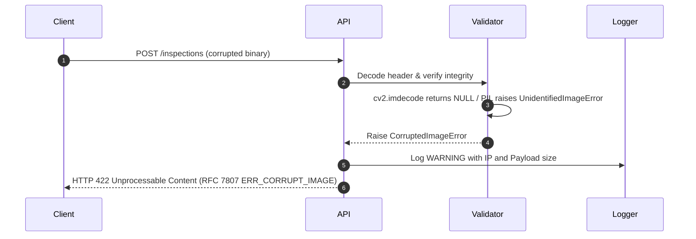

# VisionInspect AI — Error Handling & Reliability Specification

**Document ID:** VIA-ARCH-ERR-001  
**Version:** 1.0.0  
**Phase:** Phase 1 — Requirements Analysis & System Architecture Design  
**Author:** Shrikrishna Chavan (Individual Contributor)  
**Branch:** `shrikrishna-chavan`  
**Status:** Approved for Design Baseline  

---

## 1. Reliability Philosophy: The Fail-Safe Mandate

In manufacturing quality control, shipping a defective part to a customer (**False PASS / Type II Error**) can trigger line stoppages, warranty claims, or product recalls. In contrast, routing a questionable part to a human quality inspector for manual verification (**False REVIEW / Type I Error**) incurs minor labor overhead.

Therefore, VisionInspect AI enforces the **Fail-Safe Mandate**:
> **Under no circumstances shall system instability, sensor degradation, algorithmic uncertainty, or partial pipeline failure result in a default or unearned `PASS` disposition.**

All failure states must degrade safely into either:
1. A managed terminal client error (HTTP 4xx/5xx with RFC 7807 problem details), or
2. A safe operational routing to **`REVIEW`** (or `REJECT` on high-criticality production configurations).

---

## 2. Comprehensive Fault Matrix & Handling Strategy

| Failure Scenario | Classification | Terminal vs Recoverable | System Action & Internal Mechanism | User-Facing Disposition / HTTP Code |
| :--- | :--- | :--- | :--- | :--- |
| **Invalid Image Format** (e.g. BMP, TIFF, GIF) | Pre-flight Ingestion | **Terminal** | Rejected at API boundary via MIME sniffing and magic number validation. | HTTP 415 Unsupported Media Type (`ERR_INVALID_IMAGE_FORMAT`) |
| **Corrupted / Truncated Image** | Pre-flight Ingestion | **Terminal** | Decoding error intercepted in `ImageValidator` using PIL/OpenCV buffer check. Zero memory allocation for tensors. | HTTP 422 Unprocessable Content (`ERR_CORRUPT_IMAGE`) |
| **Unsupported Category** (e.g. `gear`) | Routing / Dispatch | **Terminal** | Category slug checked against database catalog. Request aborted before pipeline instantiation. | HTTP 422 Unprocessable Content (`ERR_UNSUPPORTED_CATEGORY`) |
| **Missing Model Artifact** (File not on disk) | Infrastructure Fault | **Terminal** | Model loader fails during dynamic lookup. System logs CRITICAL alert with path and expected SHA-256 hash. | HTTP 503 Service Unavailable (`ERR_MODEL_UNAVAILABLE`) |
| **Model Loading Failure** (Corrupted `.pt` or CUDA OOM) | Infrastructure Fault | **Terminal / Fallback** | If CUDA OOM occurs, dispatcher drops GPU cache (`torch.cuda.empty_cache()`) and retries on CPU. If corrupted, terminates. | HTTP 503 Service Unavailable (`ERR_MODEL_LOAD_FAILED`) |
| **Inference Timeout** ($> 5000\text{ ms}$) | Performance Fault | **Terminal / Fail-Safe** | `asyncio.wait_for` terminates inference thread. Inspection recorded as FAILED in DB. | HTTP 504 Gateway Timeout (`ERR_INFERENCE_TIMEOUT`) |
| **Missing / NaN Prediction Output** | Algorithmic Anomaly | **Recoverable (Fail-Safe)**| Post-processor intercepts NaN/Inf values. Bypasses normal pass logic and forces QC engine to trigger safety fallback. | HTTP 201 Created with Disposition: **`REVIEW`** (Justification: "Model produced unstable numerical tensors") |
| **Invalid Mask Dimensions** (Mismatch with source) | Transformation Fault | **Recoverable (Fail-Safe)**| Interpolation rescales mask to match $(H_{\text{orig}}, W_{\text{orig}})$. If aspect ratio distorted, routes to REVIEW. | HTTP 201 Created with Disposition: **`REVIEW`** |
| **Database Failure (Mid-Transaction)** | Persistence Fault | **Terminal** | SQLAlchemy session triggers automatic rollback (`session.rollback()`). Zero orphan records written. | HTTP 500 Internal Server Error (`ERR_DATABASE_ERROR`) |
| **Artifact Storage Failure** (Disk full) | Storage Fault | **Terminal** | Asynchronous disk write throws `IOError`. Triggers DB transaction abort and alerts sysadmin. | HTTP 507 Insufficient Storage (`ERR_STORAGE_FAILURE`) |
| **Uncertain Prediction** (Score in $[\tau_{\text{pass}}, \tau_{\text{review}})$) | Domain / Business Logic | **Recoverable (Operational)**| QC Rule Engine identifies marginal anomaly score or low model confidence. | HTTP 201 Created with Disposition: **`REVIEW`** |

---

## 3. Detailed Failure Scenarios & Recovery Procedures

### 3.1 Scenario: Corrupted Image Binary

- **Guarantees:** No PyTorch tensors are created; GPU memory is untouched; database transaction is never initiated.

### 3.2 Scenario: Inference Timeout Enforcement
- **Implementation:**
  ```python
  try:
      output = await asyncio.wait_for(
          run_in_threadpool(model_runner.predict, tensor),
          timeout=5.0  # 5 seconds strict SLA
      )
  except asyncio.TimeoutError:
      logger.error("Inference timed out for category %s after 5000ms", category)
      await inspection_repo.mark_failed(inspection_id, error="Inference execution timeout")
      raise InferenceTimeoutException("Model inference exceeded maximum execution deadline")
  ```
- **Guarantees:** Runaway inference loops (e.g. huge coreset distance queries or hardware stalls) cannot exhaust worker threads.

### 3.3 Scenario: Algorithmic Uncertainty & Safety Fallback
- **Trigger:**
  - Anomaly score falls inside the ambiguous band: $\tau_{\text{pass}} \le S_{\text{norm}} < \tau_{\text{review}}$.
  - Model confidence metric is below minimum threshold ($\text{confidence} < 0.80$).
  - Post-processing detects isolated anomalies that are smaller than known defect patterns but too intense to be dismissed as sensor noise.
- **System Action:**
  - QC Rule Engine generates a `QCDecision` with disposition `Disposition.REVIEW`.
  - Explanations array records: `["Anomaly score 0.52 falls within uncertain review band [0.45, 0.60)", "Flagged for manual operator confirmation"]`.
  - Transaction commits successfully with status `COMPLETED`.
  - Frontend dashboard renders amber banner alerting the line operator to inspect the visual overlay.

### 3.4 Scenario: Database Disconnect & Transaction Rollback
- **Mechanism:**
  - The persistence coordinator uses an atomic context manager:
    ```python
    async with async_session_maker() as session:
        async with session.begin():
            session.add(inspection_record)
            session.add(result_record)
            session.add_all(defect_records)
            # Commit happens automatically on exit; rollback on exception
    ```
- **Guarantees:** If the connection drops or a constraint fails during child insertions, all operations roll back completely, ensuring 0% database corruption or orphan data.

---

## 4. Health Check Probes & Self-Healing Architecture

1. **Liveness Probe (`GET /health/live`):**
   - Verifies the Python asyncio event loop is responsive.
   - If unresponsive, container orchestration (Docker / Kubernetes) automatically restarts the container instance within 15 seconds.
2. **Readiness Probe (`GET /health/ready`):**
   - Executes `SELECT 1` query to verify active PostgreSQL connection.
   - Verifies all model artifact files exist on disk for all active categories.
   - If checks fail, returns HTTP 503, preventing the load balancer from routing production traffic to that node.
