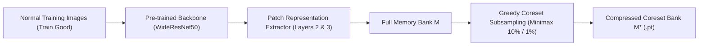

# VisionInspect AI — Machine Learning Architecture Specification

**Document ID:** VIA-ARCH-ML-001  
**Version:** 1.0.0  
**Phase:** Phase 1 — Requirements Analysis & System Architecture Design  
**Author:** Shrikrishna Chavan (Individual Contributor)  
**Branch:** `shrikrishna-chavan`  
**Status:** Approved for Design Baseline  

---

## 1. Executive Summary & Machine Learning Strategy

VisionInspect AI addresses automated visual inspection by implementing two complementary, conceptually distinct modeling paradigms:

1. **PatchCore (Cold-Start / Unsupervised Anomaly Detection):** Operates under **one-class classification** using *only normal, defect-free samples* during training. This mimics factory reality where millions of flawless parts are produced, but defective parts are rare, diverse, and unpredictable.
2. **U-Net (Supervised Defect Segmentation):** Operates under **fully supervised binary semantic segmentation**, trained on paired examples of defective products and ground truth pixel masks. U-Net provides a benchmark for scenarios where historical labeled defects are available.
3. **ResNet18 (Optional Defect Classification):** A conditional baseline for category-level or multi-class defect classification, evaluated only when sufficient class-balanced data is available.

---

## 2. Supervised U-Net Architecture Design

### 2.1 Model Architecture & Topography
The U-Net architecture is an encoder-decoder convolutional network with symmetrical skip connections:
- **Contracting Path (Encoder):** 4 downsampling stages. Each stage consists of two $3\times 3$ convolutional layers (with batch normalization and ReLU activations) followed by a $2\times 2$ max pooling operation with stride 2. Feature map channels increase: $64 \rightarrow 128 \rightarrow 256 \rightarrow 512$.
- **Bottleneck:** Two $3\times 3$ convolutions with 1024 channels.
- **Expanding Path (Decoder):** 4 upsampling stages. Each stage uses a $2\times 2$ transpose convolution (stride 2) that halves channel depth and doubles spatial resolution, concatenated with the corresponding high-resolution skip feature map from the encoder stage, followed by two $3\times 3$ convolutions.
- **Output Head:** A final $1\times 1$ convolution mapping 64 channels to 1 channel, passed through a Sigmoid activation function $\sigma(z) = \frac{1}{1 + e^{-z}}$.

### 2.2 Input and Output Contracts
- **Input Contract:**
  - Shape: `(B, 3, 256, 256)` float32 tensor.
  - Value range: Standardized with ImageNet mean $[0.485, 0.456, 0.406]$ and std $[0.229, 0.224, 0.225]$.
- **Output Contract:**
  - Probability Map: `(B, 1, 256, 256)` float32 tensor with values strictly in $[0.0, 1.0]$.
  - Binary Mask: `(B, 1, 256, 256)` uint8 tensor generated by thresholding against $\tau_{\text{binary}}$.

### 2.3 Image-Mask Pairing & Data Preparation
- MVTec AD ground truth masks are 1-channel 8-bit PNG images where pixel value 0 represents background (normal) and 255 represents defect.
- For normal training images, an all-zero synthetic mask of shape $(H, W)$ is automatically paired.
- Data augmentations (random horizontal/vertical flips, minor affine rotation $\pm 10^\circ$, slight color jitter) are applied jointly to both the input image and its paired ground truth mask.

### 2.4 Loss Function Formulation
In manufacturing defect segmentation, defective pixels typically represent $< 2\%$ of the total surface area. Standard Binary Cross-Entropy (BCE) suffers severe gradient starvation due to extreme class imbalance. VisionInspect AI implements a **Combined BCE + Soft Dice Loss** (or Focal Loss):

$$\mathcal{L}_{\text{total}} = \alpha \mathcal{L}_{\text{BCE}} + (1 - \alpha) \mathcal{L}_{\text{Dice}}$$

Where:
$$\mathcal{L}_{\text{BCE}} = -\frac{1}{N} \sum_{i=1}^N \left[ y_i \log(\hat{y}_i) + (1 - y_i) \log(1 - \hat{y}_i) \right]$$
$$\mathcal{L}_{\text{Dice}} = 1 - \frac{2 \sum_{i=1}^N y_i \hat{y}_i + \epsilon}{\sum_{i=1}^N y_i + \sum_{i=1}^N \hat{y}_i + \epsilon}$$

With weighting parameter $\alpha = 0.5$ and smoothing factor $\epsilon = 1.0$.

### 2.5 Training & Validation Workflow
- **Optimizer:** AdamW with initial learning rate $\eta = 10^{-4}$ and weight decay $\lambda = 10^{-4}$.
- **Learning Rate Schedule:** Cosine Annealing scheduler over 100 epochs with 5-epoch warm-up.
- **Batch Size:** 16 (or 8 depending on GPU VRAM availability).
- **Validation Checkpoint Criteria:** Model checkpoints are evaluated every epoch; the checkpoint with the highest validation mean Intersection over Union (mIoU) on held-out validation masks is retained.

### 2.6 Checkpoint Format
Saved as a standard PyTorch serialization dictionary (`.pt` file):
```python
{
    "epoch": 82,
    "model_state_dict": model.state_dict(),
    "optimizer_state_dict": optimizer.state_dict(),
    "best_val_iou": 0.784,
    "architecture": "unet_standard",
    "input_resolution": [256, 256],
    "category": "bottle",
    "timestamp": "2026-11-17T20:00:00Z"
}
```

### 2.7 Evaluation Metrics
- **Pixel-level Intersection over Union (IoU / Jaccard Index):**
  $$\text{IoU} = \frac{|P \cap Y|}{|P \cup Y|} = \frac{\text{TP}}{\text{TP} + \text{FP} + \text{FN}}$$
- **Dice Coefficient (F1 Score):**
  $$\text{Dice} = \frac{2 \times \text{TP}}{2 \times \text{TP} + \text{FP} + \text{FN}}$$
- **Pixel-level AUROC & Per-Region Overlap (PRO):** Measures segmentation localization across all possible threshold levels.

---

## 3. PatchCore Anomaly Detection Architecture Design

### 3.1 Normal-Only Training Approach
PatchCore builds an empirical representation of normal product appearance without requiring a single defect sample:
1. Normal training images pass through a pre-trained convolutional backbone.
2. Locally aggregated patch feature vectors are extracted across the entire normal training corpus.
3. The resulting high-dimensional feature memory bank is compressed via greedy coreset subsampling.
4. Anomaly detection at inference time is performed via nearest-neighbor distance queries.



### 3.2 Feature Extraction & Patch Embeddings
- **Backbone:** ImageNet-pretrained `WideResNet50_2` (or `ResNet50`).
- **Feature Hierarchy:** Intermediate feature representations from `layer2` (mid-level textures) and `layer3` (higher-level contextual patterns) are extracted:
  $$\phi_2(x) \in \mathbb{R}^{C_2 \times H_2 \times W_2}, \quad \phi_3(x) \in \mathbb{R}^{C_3 \times H_3 \times W_3}$$
- **Spatial Alignment:** $\phi_3(x)$ is bilinearly upsampled to match the spatial resolution of $\phi_2(x)$ ($(64 \times 64)$ for a $256 \times 256$ input).
- **Locality Pooling:** An adaptive average pooling or $3\times 3$ neighborhood unfolding with stride 1 aggregates spatial context around each patch, concatenating channels into a unified embedding vector:
  $$p_{(h, w)} \in \mathbb{R}^{D}, \quad \text{where } D = C_2 + C_3 = 512 + 1024 = 1536$$

### 3.3 Memory Bank Construction
For a training set of $N_{\text{train}}$ normal images, the total memory bank feature collection $\mathcal{M}$ contains:
$$|\mathcal{M}| = N_{\text{train}} \times H_{\text{feat}} \times W_{\text{feat}} = N_{\text{train}} \times 64 \times 64 \approx N_{\text{train}} \times 4096 \text{ vectors}$$
For $N_{\text{train}} = 200$, this yields $\approx 819,200$ high-dimensional vectors, which is too large for low-latency nearest-neighbor search.

### 3.4 Greedy Coreset Subsampling
To achieve low inference latency without sacrificing localization precision, PatchCore uses iterative greedy coreset subsampling (minimax facility location) to select a compact subset $\mathcal{M}^* \subset \mathcal{M}$ (subsampling ratio $r \in [0.01, 0.10]$):

1. **Dimensionality Reduction:** Project vectors to lower dimension $d \ll D$ using a random Johnson-Lindenstrauss orthogonal projection matrix to accelerate distance calculations during selection.
2. **Minimax Initialization:** Select the initial vector that has the maximum distance to all others.
3. **Iterative Selection:** Iteratively add vector $m \in \mathcal{M}$ that maximizes the minimum distance to already selected coreset elements:
   $$m^* = \arg\max_{m \in \mathcal{M}} \left( \min_{n \in \mathcal{M}^*} \| m - n \|_2 \right)$$
4. The subsampled coreset $\mathcal{M}^*$ retains complete coverage of the normal feature geometry with $\le 10\%$ of original memory footprint.

### 3.5 Nearest-Neighbor Anomaly Detection & Scoring
Given a test image $x^{\text{test}}$ with patch representations $\mathcal{P}(x^{\text{test}}) = \{p_i\}_{i=1}^{H \times W}$:
- For each patch embedding $p_i$, compute its Euclidean distance to its closest neighbor in $\mathcal{M}^*$:
  $$s(p_i) = \min_{m \in \mathcal{M}^*} \| p_i - m \|_2$$
- **Anomaly Map Generation:** The patch scores are arranged on the $H_{\text{feat}} \times W_{\text{feat}}$ 2D grid, bilinearly interpolated back to original image resolution $(H, W)$, and smoothed with a 2D Gaussian kernel ($\sigma=4.0$).
- **Image-Level Anomaly Score ($S_{\text{image}}$):** Let $p^* = \arg\max_{p_i} s(p_i)$ be the patch with the highest anomaly score. To prevent outlier sensitivity, PatchCore re-weights this score using the distance to the $b$-nearest coreset neighbors:
  $$S_{\text{image}} = \left( 1 - \frac{\exp(\| p^* - m_{(1)} \|_2)}{\sum_{j=1}^b \exp(\| p^* - m_{(j)} \|_2)} \right) \cdot s(p^*)$$

### 3.6 Threshold Calibration
- $\tau_{\text{binary}}$ (pixel threshold) and $\tau_{\text{pass}}$ (image threshold) are calibrated on a dedicated validation split of normal validation images.
- The standard baseline calibration sets the image anomaly threshold at the **99th percentile** of anomaly scores observed on normal validation samples:
  $$\tau_{\text{pass}} = \text{Percentile}_{99}(\{ S_{\text{image}}(x) \mid x \in \mathcal{D}_{\text{val\_good}} \})$$
  Ensuring a maximum $1\%$ false rejection rate on nominal production parts.

### 3.7 Inference Output Contract
- `image_score`: Normalized float value $\in [0.0, 1.0]$.
- `anomaly_map`: 2D float32 array $(H, W)$ representing continuous local anomaly density.
- `binary_mask`: Thresholded 2D boolean array $(H, W)$.

---

## 4. ResNet18 Defect Classification (Optional Feature)

### 4.1 Purpose & Role
ResNet18 is treated strictly as an optional baseline classifier. It may be deployed in two configurations:
- **Binary Classifier:** Classifies image as Normal ($0$) vs Defective ($1$).
- **Multi-Class Classifier:** Classifies detected anomalies into specific defect classes (e.g., for `bottle`: `broken_large`, `broken_small`, `contamination`).

### 4.2 Conditions for Implementation
ResNet18 defect classification shall **only** be implemented if:
1. The manufacturing process generates sufficient labeled defect samples per defect subtype ($\ge 50$ distinct samples per class).
2. The operational requirement specifically demands defect subtype taxonomy rather than spatial localization.
3. *MVTec AD Reality:* Because MVTec AD provides very few defective samples per category (often only 10–20 images per defect sub-type), multi-class supervised training on MVTec AD is prone to severe overfitting and poor statistical generalization. If implemented, it will be clearly designated as an experimental baseline.

---

## 5. Model Comparison & Fair Evaluation Protocol

### 5.1 Supervision Differences

| Dimension | PatchCore | U-Net | ResNet18 (Optional) |
| :--- | :--- | :--- | :--- |
| **Supervision Paradigm** | Unsupervised / One-Class | Fully Supervised | Supervised |
| **Training Data Required** | 100% Normal (Good) samples only | Paired defective images + pixel masks | Class-labeled defect samples |
| **Defect Prior Knowledge** | Zero prior knowledge of defect shapes | Biased toward training defect types | Biased toward training defect classes |
| **Output Type** | Image anomaly score + continuous heatmap | Pixel-level probability map | Categorical classification logits |
| **Industrial Suitability** | High for cold starts & novel defects | High when defect types are recurring | Moderate (classification only, no masks) |

### 5.2 Fair Evaluation Protocol on Held-Out Test Data
To ensure a fair, rigorous comparative evaluation without bias:
1. **Identical Held-Out Test Set:** Both PatchCore and U-Net shall be evaluated against the exact same held-out test split containing identical normal and defective samples.
2. **Strict Training Isolation:**
   - PatchCore shall be fitted **only** on the normal training images.
   - U-Net shall be trained on a designated training subset of defect and normal images. Under no circumstances may U-Net be evaluated on samples it observed during training.
3. **Primary Evaluation Metrics:**
   - **Image-level AUROC (Area Under ROC Curve):** Evaluates part-level defect discrimination across all classification thresholds.
   - **Pixel-level AUROC & PRO (Per-Region Overlap):** Evaluates localization fidelity regardless of binarization threshold.
   - **Pixel IoU & Dice Score:** Evaluates segmentation precision at the operational binarization threshold $\tau_{\text{binary}}$.
   - **Inference Latency (ms):** Wall-clock execution time on identical hardware.

> **Important Scientific Disclosure:** No model accuracy, AUROC, or IoU figures are fabricated in this design specification. Empirical performance numbers will be measured during Phase 3 and Phase 4 model training and recorded directly into experiment manifests and the Model Registry.
