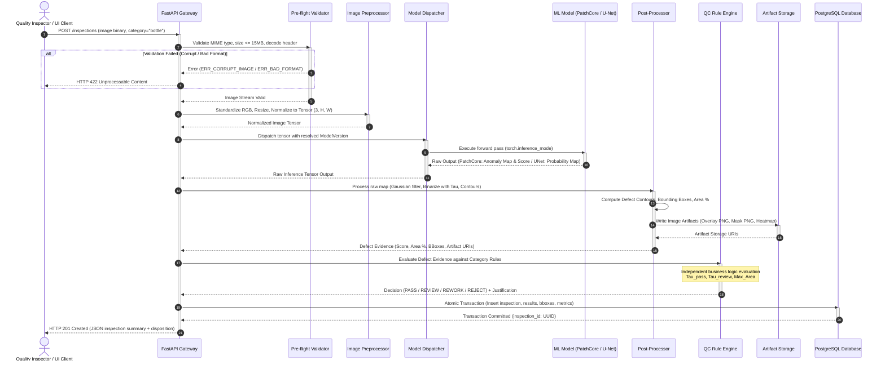
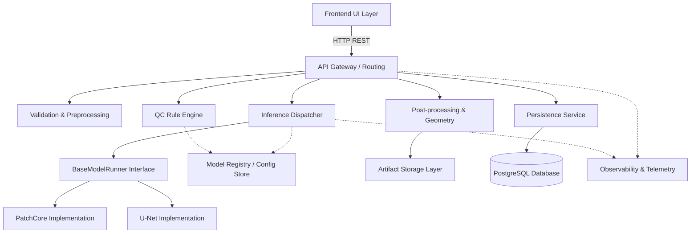

# VisionInspect AI — System Architecture Specification

**Document ID:** VIA-ARCH-SYS-001  
**Version:** 1.0.0  
**Phase:** Phase 1 — Requirements Analysis & System Architecture Design  
**Author:** Shrikrishna Chavan (Individual Contributor)  
**Branch:** `shrikrishna-chavan`  
**Status:** Approved for Design Baseline  

---

## 1. Architectural Philosophy & Principles

VisionInspect AI is engineered as an industrial-grade, modular automated visual quality inspection platform. The architecture is guided by six foundational design principles:

1. **Separation of Evidence and Adjudication:**  
   Machine learning models act strictly as *evidence generators* (producing objective anomaly maps, probability distributions, and geometric contours). The *Quality Control (QC) Rule Engine* acts as an independent *adjudicator*, evaluating operational business rules against this evidence. At no point does a neural network make direct PASS/REJECT business decisions.
2. **Defensive Fail-Safe Posture:**  
   In industrial manufacturing, a false PASS (escaped defect shipped to a customer) carries catastrophic liability compared to a false REJECT or REVIEW. Any model uncertainty, corrupted telemetry, or pipeline degradation defaults to `REVIEW`, never `PASS`.
3. **Stateless Scalability:**  
   The API and inference workers are entirely stateless. All persistent state resides in transactional relational storage (PostgreSQL) and structured artifact stores. Workers can scale horizontally behind load balancers.
4. **Deterministic Reproducibility:**  
   Every inspection decision is fully auditable. Inspections record the exact image SHA-256 hash, model architecture, checkpoint version ID, active QC configuration parameters, and execution latency.
5. **Agnostic ML Model Abstraction:**  
   The inference orchestration layer communicates with models through an abstract interface (`BaseModelRunner`). The backend operates identically whether backed by PatchCore, U-Net, or future edge-optimized runtimes (ONNX/TensorRT).
6. **No Uncalibrated Physical Claims:**  
   All defect dimensions are maintained in image pixel units ($px$) and area percentages ($\%$). Uncalibrated physical metric measurements (e.g., millimeters) are strictly prevented.

---

## 2. High-Level System Architecture

The following diagram illustrates the 10 logical components of VisionInspect AI and their interconnects:

```mermaid
flowchart TD
    subgraph ClientLayer["1. Client & Presentation Layer"]
        UI["React Web Dashboard\n(Vite + TailwindCSS)"]
        Operator["Quality Inspector / Line Supervisor"]
        Operator -->|Uploads image / inspects results| UI
    end

    subgraph APILayer["2. API & Gateway Layer"]
        Gateway["FastAPI Gateway / Application Server\n(Async HTTP, CORS, Auth, Validation)"]
        UI -->|HTTP multipart/form-data & JSON REST| Gateway
    end

    subgraph PreprocessingLayer["3. Image Validation & Preprocessing"]
        Validator["Pre-flight Validator\n(MIME, Header, Size, Format)"]
        Preproc["Image Preprocessor\n(Resize, RGB Normalize, Tensor Transform)"]
        Gateway -->|Raw image bytes| Validator
        Validator -->|Valid image stream| Preproc
    end

    subgraph InferenceSubsystem["4. ML Inference & Model Subsystem"]
        ModelRegistry["5. Model Registry & Config Store\n(Metadata, Weights, Coreset, Checkpoints)"]
        Dispatcher["Inference Dispatcher\n(Hardware Routing: CUDA / CPU)"]
        
        subgraph ModelPipelines["Model Implementations"]
            PatchCore["PatchCore Pipeline\n(WideResNet50 Backbone + Memory Bank Coreset)"]
            UNet["U-Net Pipeline\n(Encoder-Decoder Defect Segmentation)"]
        end

        Preproc -->|Normalized Tensor (3, H, W)| Dispatcher
        ModelRegistry -.->|Load weights / coreset| Dispatcher
        Dispatcher -->|Route tensor| PatchCore
        Dispatcher -->|Route tensor| UNet
    end

    subgraph PostprocessingLayer["6. Post-Processing & Geometry Engine"]
        Postproc["Post-Processor\n(Gaussian Smoothing, Binarization, Contours)"]
        OverlayGen["Overlay Generator\n(Jet Heatmap + Bounding Boxes + Original Composite)"]
        
        PatchCore -->|Raw Anomaly Map & Score| Postproc
        UNet -->|Defect Probability Map| Postproc
        Postproc -->|Binary Mask & Contours| OverlayGen
    end

    subgraph QCLayer["7. Quality Control (QC) Rule Engine"]
        QCEngine["QC Rule Engine\n(Independent Decision Logic)"]
        QCConfig["QC Rules Config Repository\n(Per-category Thresholds & Tolerances)"]
        
        Postproc -->|Defect Evidence: Score, Area, Counts| QCEngine
        QCConfig -.->|Thresholds: Tau_pass, Tau_review, MaxArea| QCEngine
        QCEngine -->|Disposition: PASS / REVIEW / REWORK / REJECT| Gateway
    end

    subgraph PersistenceSubsystem["Storage & Persistence Subsystem"]
        subgraph DB["8. Inspection Persistence Layer"]
            PostgreSQL[(PostgreSQL Relational DB\nInspections, Results, Predictions, Metrics)]
        end
        subgraph Storage["9. Artifact Storage Layer"]
            FileStorage[("Local / Object Storage\nRaw Images, Masks, Overlays, Heatmaps")]
        end
    end

    Gateway -->|Persist transaction| PostgreSQL
    OverlayGen -->|Save visual artifacts| FileStorage
    FileStorage -.->|Return artifact URIs| Gateway
    PostgreSQL -.->|Query history & analytics| Gateway

    subgraph ObservabilityLayer["10. Monitoring, Logging & Telemetry"]
        Logging["Structured JSON Logger\n(Correlation ID, Latency, Errors)"]
        Metrics["Prometheus Metrics Collector\n(/metrics endpoint)"]
        Gateway -.->|Log context| Logging
        Dispatcher -.->|Inference timing| Metrics
    end
```

---

## 3. Logical Component Breakdown & Responsibilities

### 3.1 Component 1: Frontend Layer (React Web Dashboard)
- **Technology:** React 18, TypeScript, TailwindCSS, Lucide Icons, Vite.
- **Responsibilities:**
  - Provides a single-pane-of-glass operator interface for production lines.
  - Enables drag-and-drop image uploads with category selection (`bottle`, `metal_nut`, `tile`).
  - Renders synchronized, multi-panel visual inspections: raw original image, continuous anomaly heatmap overlay, binary segmentation mask, and bounding-box annotated defect regions.
  - Displays color-coded QC disposition cards (`PASS` = Green, `REVIEW` = Amber, `REWORK` = Blue, `REJECT` = Red) with explicit textual justifications.
  - Provides historic inspection filtering, search, and yield analytics visualizations (Pareto charts, defect area distributions, throughput trends).
- **Communication:** Consumes backend REST API endpoints over HTTP/JSON and static artifact streams.

### 3.2 Component 2: API & Gateway Layer (FastAPI Backend)
- **Technology:** FastAPI, Python 3.10+, Uvicorn, Pydantic v2.
- **Responsibilities:**
  - Serves as the central API gateway and orchestration controller.
  - Enforces schema validation, header parsing, and CORS policies.
  - Generates unique correlation IDs (`X-Request-ID`) for distributed request tracing.
  - Manages asynchronous request lifecycles, database connection pools, and exception envelopes conforming to RFC 7807 Problem Details.
  - Coordinates pipeline handoffs between pre-processing, inference, post-processing, QC adjudication, and persistence.
- **Communication:** Communicates with clients via HTTP REST; invokes Python domain services via asynchronous function interfaces.

### 3.3 Component 3: Image Validation & Preprocessing
- **Technology:** OpenCV (`cv2`), Pillow (`PIL`), NumPy, PyTorch `torchvision.transforms`.
- **Responsibilities:**
  - **Pre-flight Validation:** Checks file MIME type, file size ($\le 15\text{ MB}$), header integrity, and dimensions ($256\times 256$ to $4096\times 4096$). Rejects corrupt or invalid streams with RFC 7807 error envelopes.
  - **Color Normalization:** Converts arbitrary inputs (grayscale 1-channel, RGBA 4-channel, BGR) to standardized 3-channel RGB.
  - **Spatial Standardizing:** Resizes images to model input resolution (default $256\times 256$ for PatchCore and U-Net) using bilinear interpolation with antialiasing.
  - **Tensor Normalization:** Converts pixel values to $[0.0, 1.0]$ float tensors and applies ImageNet standard normalization:
    $$\mu = [0.485, 0.456, 0.406], \quad \sigma = [0.229, 0.224, 0.225]$$
- **Communication:** Ingests raw byte streams from the Gateway; emits standardized PyTorch tensors `(1, 3, H, W)`.

### 3.4 Component 4: ML Inference Layer
- **Technology:** PyTorch 2.x, TorchScript / Torch Inference Mode.
- **Responsibilities:**
  - Hosts model execution workers in non-blocking threads with device routing (CUDA GPU acceleration if available; fallback to CPU).
  - Enforces `torch.inference_mode()` to eliminate gradient computation overhead and memory retention.
  - **PatchCore Runner:** Extracts mid-level neighborhood feature embeddings from pre-trained WideResNet50 / ResNet50 backbones, projects against coreset memory banks, and computes $k$-NN anomaly scores and 2D anomaly maps.
  - **U-Net Runner:** Executes supervised forward passes producing 2D defect probability maps.
  - Enforces inference execution deadlines (timeout $\le 5,000\text{ ms}$).
- **Communication:** Receives normalized image tensors; emits structured `ModelInferenceOutput` (raw score scalar, 2D continuous anomaly map tensor).

### 3.5 Component 5: Model Registry & Configuration Store
- **Technology:** Filesystem artifact store, YAML/JSON configuration files, PostgreSQL `model_versions` & `model_configurations` metadata tables.
- **Responsibilities:**
  - Tracks model checkpoints (`.pt` files) and PatchCore coreset memory banks (`coreset.pt`).
  - Maintains cryptographic SHA-256 hashes for all weights to prevent artifact tampering.
  - Stores category-to-model active version mappings and input resolution specifications.
  - Supports dynamic model resolution and fallback mechanisms for unconfigured categories.
- **Communication:** Queried by the Inference Dispatcher during startup and inference routing.

### 3.6 Component 6: Post-processing & Geometry Engine
- **Technology:** OpenCV (`cv2`), SciPy (Gaussian filters), NumPy.
- **Responsibilities:**
  - **Spatial Filtering:** Applies 2D Gaussian smoothing ($\sigma=4$) to raw anomaly maps to attenuate high-frequency patch boundary artifacts.
  - **Binarization:** Applies category-specific calibrated threshold $\tau_{\text{binary}}$ to create a binary defect mask $B \in \{0, 1\}^{H \times W}$.
  - **Morphological Cleaning:** Performs morphological opening ($3\times 3$ or $5\times 5$ elliptical kernel) to eliminate isolated pixel sensor noise.
  - **Contour & Cluster Analysis:** Discovers connected components (`cv2.findContours`); extracts bounding boxes $[x_{\min}, y_{\min}, x_{\max}, y_{\max}]$, centroid coordinates, and component pixel areas.
  - **Area Quantification:** Calculates total defect pixel count $A_{\text{total}}$, defect area ratio $\rho = \frac{A_{\text{total}}}{H \times W} \times 100\%$, and maximum component area $A_{\max}$.
  - **Visualization Generation:** Blends the original RGB image with a pseudo-color Jet/Turbo heatmap overlay and renders highlighted bounding boxes around detected defect clusters.
- **Communication:** Consumes raw model tensor output; emits structured defect geometry metrics and writes visual image assets.

### 3.7 Component 7: Quality Control (QC) Rule Engine
- **Technology:** Pure Python domain service, Pydantic rule schema models.
- **Responsibilities:**
  - **Decoupled Business Logic:** Implements industrial adjudication logic completely decoupled from neural network weights.
  - **Configurable Rules:** Evaluates per-category rule sets containing:
    - $\tau_{\text{pass}}$: Anomaly score upper bound for normal certification.
    - $\tau_{\text{review}}$: Lower bound for manual operator inspection.
    - $A_{\text{rework}}$: Maximum permissible defect area percentage eligible for salvage/rework.
    - $A_{\text{reject}}$: Critical defect area percentage requiring immediate scrapping.
    - $C_{\max\_defects}$: Maximum acceptable count of discrete defect clusters.
  - **Deterministic Decision:** Emits exactly one of `PASS`, `REVIEW`, `REWORK`, `REJECT`.
  - **Rule Justification:** Generates human-readable explanations detailing which predicates triggered the decision.
  - **Fail-Safe Routing:** Any execution irregularity, model uncertainty, or missing evidence immediately defaults to `REVIEW`.
- **Communication:** Receives defect metrics from the Post-processor; returns disposition and justification payload to the Gateway.

### 3.8 Component 8: Inspection Persistence Layer
- **Technology:** PostgreSQL 15+, SQLAlchemy 2.0 (AsyncIO), Alembic migrations.
- **Responsibilities:**
  - Enforces relational integrity across inspection transactions.
  - Persists root inspection records, category foreign keys, model version references, timing metrics, and artifact URIs.
  - Stores child records for inspection results and granular defect bounding box predictions.
  - Ensures audit immutability (committed inspection records cannot be modified).
  - Serves indexed queries for paginated inspection history and analytics aggregations.
- **Communication:** Interacts with the Gateway via asynchronous connection pooling (`asyncpg`).

### 3.9 Component 9: Artifact Storage Layer
- **Technology:** Local structured filesystem storage (expandable to S3/MinIO object storage).
- **Responsibilities:**
  - Organizes and stores high-volume binary assets:
    - `/artifacts/images/raw/{category}/{yyyy}/{mm}/{dd}/{uuid}.jpg`
    - `/artifacts/images/overlay/{category}/{yyyy}/{mm}/{dd}/{uuid}_overlay.png`
    - `/artifacts/images/masks/{category}/{yyyy}/{mm}/{dd}/{uuid}_mask.png`
  - Ensures atomic asynchronous disk writes offloaded from the main event loop.
  - Enforces directory structure isolation and lifecycle retention policies.
- **Communication:** Receives image buffers from the Post-processor; returns relative URIs to the Gateway and Database.

### 3.10 Component 10: Monitoring, Logging & Telemetry
- **Technology:** Python `logging` with JSON formatting, Prometheus Client (`prometheus_client`).
- **Responsibilities:**
  - Outputs structured JSON log lines containing correlation IDs, timestamps, categories, execution stages, and error stack traces.
  - Tracks key operational metrics:
    - `inspection_requests_total{category, disposition, status}`
    - `inference_duration_seconds{category, model}` (histogram)
    - `end_to_end_duration_seconds{category}` (histogram)
    - `active_workers_count`
  - Provides `/health/live` and `/health/ready` probes for container orchestration.
- **Communication:** Intercepts API lifecycle via FastAPI middleware; exposes metrics endpoint `/metrics`.

---

## 4. End-to-End Inspection Request Lifecycle

The sequential progression of a single inspection request through all architectural boundaries is modeled below:



---

## 5. Component Dependency & Isolation Topology

To ensure strict maintainability and testability, dependencies flow strictly unidirectionally from outer interface layers to inner domain abstractions:



---

## 6. Separation of Concerns: Evidence vs Decision Logic

A critical failure mode in automated inspection systems is hardcoding business decisions into model inference heads. VisionInspect AI enforces an uncompromising architectural boundary between **Machine Learning Inference** and **Quality Control Decision Logic**:

```
+-------------------------------------------------------+
|                 ML INFERENCE ENGINE                   |
|  - Role: Objective Evidence Generator                 |
|  - Outputs: Continuous Anomaly Map M, Raw Score S     |
|  - Knows nothing of PASS, REVIEW, REWORK, REJECT     |
|  - Knows nothing of factory scrap tolerances          |
+-------------------------------------------------------+
                           |
                           | Defect Evidence Contract:
                           | { anomaly_score, area_ratio_pct,
                           |   defect_count, bounding_boxes }
                           v
+-------------------------------------------------------+
|                 QC RULE ENGINE                        |
|  - Role: Business Adjudicator                         |
|  - Evaluates externalized business rules per category |
|  - Determines operational disposition:               |
|      * PASS   * REVIEW   * REWORK   * REJECT          |
|  - Generates human-auditable justification strings    |
+-------------------------------------------------------+
```

### Why This Separation is Mandatory:
1. **Dynamic Business Calibration:** Factory line supervisors frequently adjust scrap thresholds due to raw material variations or customer tolerance tiers without retraining or redeploying neural network weights.
2. **Deterministic Auditability:** If a manufactured unit is rejected, quality assurance engineers can inspect the exact rule predicate that triggered the scrap disposition (e.g., `Defect area 3.2% exceeded maximum rework threshold 2.0%`), rather than treating the neural network as an inscrutable black box.
3. **Fail-Safe Guarantee:** If model outputs exhibit anomalous variance or degraded confidence, the QC engine detects the out-of-bounds evidence and safely routes the unit to `REVIEW`, overriding any potential erroneous pass.
